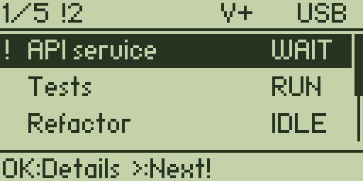
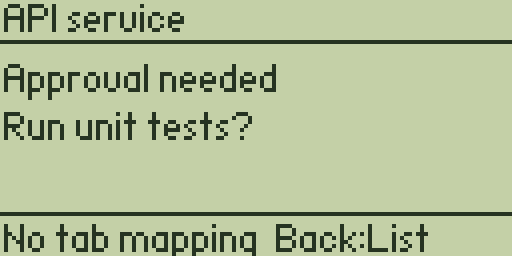
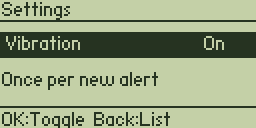

# Flipper Agent Deck

A USB dashboard and controller for AI coding agents: **Python on the PC, C on the
Flipper Zero**. The Flipper app is a normal `.fap`; exit it to return to the
device's other tools.

**Status: first working iteration.** Built and tested on Windows with official
Flipper firmware **1.5.1, API 88.2**. The app is installed under Apps → Tools →
Agent Deck. Other firmware APIs need a compatible build; earlier firmware has not
been tested. Codex CLI structured questions, independent session states, and muted
question notifications have been verified live. Codex CLI is the primary
integration target. Desktop-app behavior has not been independently validated;
desktop-specific conversation navigation is not implemented.

## What works

- Automatic registration from participating Codex sessions, using lifecycle hooks.
- A stable, scrollable overview with three visible rows and up to **16 sessions**.
  When sessions share a project name, a short identifier distinguishes them.
- Persistent session names set from the PC, plus scrollable project path and
  session ID information on the Flipper.
- A Python companion window with live Flipper status, session naming, background
  bridge controls, and an activity/error view.
- Selected-session controls on the Flipper and PC: Open on PC, Stop turn,
  Continue, Approve once, and Reject. Available actions depend on the live
  session and pending request; see **Agent controls** below.
- Details showing why an agent needs attention and a short command/question summary.
- Approval-request notifications and handling of structured question hook events
  when the host supplies them. One brief vibration for a new event, with
  simultaneous events combined into one pulse. Heartbeats and duplicate reports
  do not repeat it. See question coverage below for tool-specific limitations.
- A saved vibration on/off preference. Muting leaves the screen notifications
  active. When enabled, the Flipper's global notification settings still apply.
- USB handshake, automatic reconnect, stale-status indication, and bounded parsing.
- Optional Windows Terminal focusing for sessions with a known tab mapping.
- A local event journal that can recover reported sessions when the bridge starts
  after Codex. Dead process identities are checked before displaying old sessions.

Actual device screenshots, enlarged without smoothing:

| Overview | Agent details | Settings |
| --- | --- | --- |
|  |  |  |

## Requirements

- Flipper Zero with a microSD card and a **USB data cable**.
- Official firmware 1.5.1 for the supplied development build.
- Windows and Python **3.9 or newer** for the tested companion setup. Dependencies
  are `pyserial`, `psutil`, and `websocket-client`; no OpenAI API key is needed by
  the companion. It uses your existing signed-in Codex installation.
- A Codex installation supporting lifecycle hooks. Hooks must be enabled, allowed
  by local policy, and reviewed/trusted by the user.
- A running Agent Deck companion on the same PC as the supported local sessions.
- Windows Terminal plus a known tab identifier if terminal focusing is wanted.
- For agent controls, a Codex CLI with the shared local app-server protocol and
  `codex app-server proxy` (developed against **0.163.0**). The local protocol is
  experimental and may change between versions.

The Python code is written to be portable, and CI is configured for Windows and
Linux tests. Real-device testing so far has been on Windows.

## Install from this checkout

In PowerShell at the repository root:

```powershell
py -m venv .venv
.\.venv\Scripts\python.exe -m pip install -e .

# Preview the Codex hook configuration, then save it:
.\.venv\Scripts\python.exe -m agent_deck install-hooks
.\.venv\Scripts\python.exe -m agent_deck install-hooks --apply
```

The installer merges with `~/.codex/hooks.json`, preserves existing integrations
(including the earlier Stream Deck helpers), and saves a timestamped backup.
It does not change Codex's approval policy or return approval decisions.

Open **`/hooks` in Codex CLI**, review the definitions pointing to
`scripts/codex-hook.py`, and trust them if needed. Start or resume a session after
initial setup if it has not loaded the hooks. See the
[official Codex hooks documentation](https://learn.chatgpt.com/docs/hooks).

This is currently a source-checkout installation: keep the checkout and virtual
environment in place. Moving them requires updating the installed hook paths.

### Build and install the Flipper app

[uFBT](https://github.com/flipperdevices/flipperzero-ufbt) downloads the official
SDK and compiler. Pin the SDK to the firmware version being used:

```powershell
.\.venv\Scripts\python.exe -m pip install ufbt==0.2.6
$env:UFBT_HOME = Join-Path $PWD '.tools\ufbt'
.\.venv\Scripts\ufbt.exe update --hw-target=f7 --url=https://update.flipperzero.one/builds/firmware/1.5.1/flipper-z-f7-sdk-1.5.1.zip

Push-Location flipper
..\.venv\Scripts\ufbt.exe
..\.venv\Scripts\ufbt.exe launch
Pop-Location
```

The binary is `flipper/dist/agent_deck.fap`. Alternatively, copy it to
`/ext/apps/Tools/agent_deck.fap` with qFlipper. **Close Agent Deck before replacing
or relaunching it**: hold Back on the Flipper. If multiple USB ports/devices are
present, pass `FLIP_PORT=COM3` (substitute the device's normal CLI port) to uFBT.

### Run

Launch **Apps → Tools → Agent Deck** on the Flipper, then start the companion:

```powershell
.\.venv\Scripts\python.exe -m agent_deck run
```

Keep this process running; Ctrl+C stops it. A convenience wrapper is also provided:

```powershell
.\scripts\Start-Bridge.ps1
```

To run without keeping a terminal window open:

```powershell
.\scripts\Start-Bridge.ps1 -Background
.\scripts\Stop-Bridge.ps1
```

Background logs and the process record are kept in `.agent-deck/` in the checkout.
The stop helper verifies the recorded process identity before stopping it.

### PC companion window

On Windows, double-click **`Open Agent Deck.cmd`** in this checkout. After the
initial Python setup, routine use does not require a terminal. Alternatively:

```powershell
.\.venv\Scripts\python.exe -m agent_deck gui
```

The window shows the Flipper connection, tracked sessions, their reported states,
and project paths. Select a session, edit **Session name**, and choose **Save
name**. **Use project name** restores its automatic name. Selection and unsaved
edits survive the automatic refresh.

**Start bridge**, **Stop bridge**, and **Restart** manage this checkout's recorded
background process. Opening the window attaches to an existing background bridge;
**closing the window leaves that bridge running**. Stop any bridge you launched
in a foreground terminal before starting another from the window. Multiple
windows share the same process record and cannot start duplicate managed bridges.
The existing PowerShell helpers use the same background manager.

Connection status comes from a current, matching bridge heartbeat rather than
the last log line. A stopped process or stale heartbeat cannot appear connected.
Errors appear in the window; **Show activity** opens the recent bridge log.
Window startup errors are logged under `.agent-deck/companion.stderr.log` when
launched with `scripts/Start-Companion.ps1`.

The GUI uses standard-library **Tkinter**, included in the tested Windows Python
installation. Python builds without Tcl/Tk need that component installed. The
CLI and foreground bridge remain usable without Tkinter. No login-startup task,
system service, or approval-policy change is installed by the companion.

The app creates a second USB serial interface. `auto` looks for the application
handshake, so port numbers do not need to be hardcoded. To inspect or select them:

```powershell
.\.venv\Scripts\python.exe -m agent_deck ports
.\.venv\Scripts\python.exe -m agent_deck run --port COM4
```

COM3/COM4 are examples. qFlipper or a serial terminal may need to be closed if it
holds the relevant port. Run one companion instance per Flipper.

### Try it without a working Codex notification

```powershell
# Five simulated agents on the device; Ctrl+C stops demo mode:
.\.venv\Scripts\python.exe -m agent_deck demo

# Or, while the live bridge is running, send a temporary ten-second test alert:
.\.venv\Scripts\python.exe -m agent_deck notify-test

# Inspect tracked sessions without opening USB:
.\.venv\Scripts\python.exe -m agent_deck status
```

Demo/test alerts never execute an agent command. The demo needs a connected
Flipper; the hook and model tests below run without hardware.

## Controls

| Input | Overview | Details | Settings |
| --- | --- | --- | --- |
| Up / Down | Select and scroll | — | — |
| Right | Next agent needing attention | — | — |
| OK | Open details | Open controls | Toggle and save vibration |
| Back | Open settings | Return to list | Return to list |
| Left | — | Return to list | Return to list |
| Hold Back | Exit app | Exit app | Exit app |

From details, **Right** opens session information. **Up/Down** scroll through the
name, project path, and full Codex session ID. **Back** returns to details.

The header shows selection/total, `!` attention count, `V+`/`V-` vibration
preference, and USB connection status. OFF in the connection indicator means the
last snapshot is stale; terminal actions are disabled. Inactivity does not change
an agent's reported state. RUN and WAIT are the short overview labels for working
and needing attention. Row order stays stable as
alerts arrive. Short names are shown in the list; longer names and summaries
appear in details.

## Session discovery and its limits

**Notifications do not require a special launcher.** User-level hooks can report
normally launched local Codex sessions. Each report identifies its session and
project. Sessions that have not loaded/trusted the hooks cannot report, and this
is not a universal scan of every agent or saved conversation on the computer.

- **Already-open sessions:** restart or resume if necessary after installing the
  hooks. Events that happened before setup cannot be reconstructed reliably.
- **First prompt:** in live testing, new sessions appeared after their first
  prompt. Opening an empty Codex window alone is not sufficient for discovery.
- **Bridge restart:** reports are stored locally in
  `%LOCALAPPDATA%\FlipperAgentDeck\events.sqlite3` on Windows. The journal includes
  session display names, project paths, and short command/question summaries, not
  conversation transcripts.
  Set `AGENT_DECK_STATE_DIR` for another directory, or `--store` on bridge commands
  for a specific database. Both hooks and bridge must use the same store.
- **Session liveness:** process IDs are checked with creation times to avoid PID
  reuse, and owners are classified as independent CLI, shared server, or unknown.
  A confirmed owner exit or `SessionEnd` removes its row. A live shared server
  does not prove an individual session is still open. An idle session can remain
  open indefinitely, so inactivity never changes its state or expires its row.
  IDLE, RUN, and WAIT retain their last reported state until a lifecycle event or
  confirmed owner exit changes them. If process metadata cannot be read, the
  reported state is retained rather than guessing that the session is closed.
- **Questions:** detection requires Codex to emit a `PreToolUse` event for
  `request_user_input`. This path was verified live in CLI Plan mode: WAIT and a
  vibration appeared, answering cleared WAIT, and a muted question remained
  visible without vibration. In the tested CLI, this tool is unavailable in
  Default mode. An earlier `request_user_input_async` test did not report the
  question; its coverage remains unverified. An asynchronous tool returning
  successfully also does not mean the user answered. Ordinary assistant-text
  questions are not inferred from punctuation. The [official hook documentation](https://learn.chatgpt.com/docs/hooks#tool-coverage)
  describes tool paths that can bypass hooks.
- **Clearing approvals:** a matching PostToolUse, a new prompt, Stop, or Interrupt
  clears the corresponding state. Hooks do not report every approval UI transition;
  a request can remain marked waiting until its tool finishes. Parallel unrelated
  tools do not clear another pending request.
- **Capacity:** the device shows the first 16 tracked sessions. The companion logs
  an explicit overflow count; closing sessions makes room for others.
- **Subagents:** rows represent reported Codex sessions. Internal subagents may
  share their parent's session ID and are not listed as separate sessions.
- **Notification recovery:** reconnecting preserves event identity. Reopening the
  device app may notify once about requests still pending.

Codex's `Stop` hook means the turn stopped; the app displays IDLE rather than
claiming that the whole task succeeded. Completion-specific notifications are
future work.

### Give sessions readable names

Use the PC companion while the live bridge is running:

```powershell
.\.venv\Scripts\python.exe -m agent_deck list
.\.venv\Scripts\python.exe -m agent_deck rename <ID-from-list> "Frontend"
.\.venv\Scripts\python.exe -m agent_deck rename <ID-from-list> "Tests"

# Return a session to its automatic project name:
.\.venv\Scripts\python.exe -m agent_deck rename <ID-from-list> --reset
```

Replace `<ID-from-list>` with the printed ID. A unique prefix of at least four
characters also works, as does the full Codex session ID. Ambiguous prefixes are
rejected. Names may contain 1–32 characters; quote names containing spaces. Names
belong to a session, survive bridge restarts and resuming that same session, and
do not change its state, selection, or pending notification. New sessions get
their project name until renamed. Duplicate display names keep a short ID prefix.

On the Flipper, open **OK → Right** to inspect the name, project path, and session
ID; use **Up/Down** to scroll. Existing sessions recorded before path reporting
show **Not reported yet** until their next hook report. Device text is rendered
in ASCII, and paths over 256 display characters end in `...`; `status` on the PC
retains the reported path (up to 4096 characters).

This update uses USB protocol **AD3**. Rebuild/reinstall the Flipper app and
restart the companion together when upgrading from AD1 or AD2. No firmware update is
needed. Hooks use their existing command definitions.

### Agent controls

Use normal **`codex`** to start agents. The companion automatically attaches a
control client to tracked sessions that are already loaded on the same shared
local Codex server. You do not have to launch them from Agent Deck. As before,
hooks register sessions after their first prompt. Agent Deck does not resume
unloaded history, guess from project titles, or change session permission/model
settings when attaching. This control client is separate from the notification
hooks, which remain observational.
It subscribes to active threads for approval events, then unsubscribes when they
become idle. Reading idle metadata does not resume historical conversations or
hold an extra live subscription. The previously documented shared-server close
grace period still applies; no inactivity-based OFF state or expiry is added.

On the Flipper, select a session, press **OK** for details, then **OK** again for
**Controls**. Use Up/Down to choose an available action. Stop, Continue, Approve,
and Reject open a review screen; scroll with Up/Down, then **press OK** to confirm.
Back cancels. The PC companion has the same actions under the selected session;
approval and rejection dialogs show the request and require explicit confirmation.

| Action | Behavior |
| --- | --- |
| Open on PC | Focus a uniquely mapped Windows Terminal tab. Without a mapping, open a new CLI window attached to the same conversation with `codex resume <session-id>`; this creates another view of that session. |
| Stop turn | Send `turn/interrupt` for that exact thread and active turn. It does not kill Codex or stop other sessions. |
| Continue | Send exactly **“Continue with the next logical step.”** as a new user message to an idle thread. |
| Approve once | Reply `accept` to the displayed command or supported file-change approval request. It never adds a permanent allow rule or grants session-wide approval. |
| Reject | Reply `decline`, or `cancel` when Codex offers only cancellation. Cancellation stops the current turn; the review screen states this. Questions are answered in Codex on the PC. |

The background bridge owns one Codex control connection. Companion windows read
its capabilities and send actions through a local SQLite mailbox, so both
surfaces refer to the same pending requests. Mailbox commands are claimed once,
expire after five seconds if not started, and cannot cross bridge restarts.
Closing the PC window leaves Flipper controls running.
New approval notifications refresh the live attachment, including after a new
turn or an additional CLI view opens. Replayed file approvals recover their exact
file-change item before enabling Approve. If Codex has not supplied those details
yet, the Flipper states that it is waiting for approval details; it does not
guess an approval from the notification summary.

Actions carry a token for the current control state. A newer turn, answered
request, changed pending request, or connection restart invalidates old controls.
The bridge rejects duplicate USB actions. Approvals are acknowledged only after
Codex reports that the exact request was resolved. An unconfirmed decision is
not resent automatically; inspect the session on PC.

The Flipper shows a complete, scrollable approval preview of up to 512 printable
ASCII characters. Longer or non-ASCII requests require PC review; Reject can
remain available. The companion supports previews up to 16 KiB. Missing command
or file-change details, stdin approvals, and session write grants also require
review in Codex. The UI only offers decisions the request allows. Other request
types, including structured questions and tool-specific permission grants, stay
on the PC. No terminal approval keys are typed.

`--no-daemon` sessions, other independent app-server processes, remote/cloud
sessions, and desktop-specific sessions are **notification-only** unless a known
terminal mapping provides Open on PC. They are not controlled by attaching to a
different server. No API key, TCP listener, remote-control pairing, or new Codex
daemon is configured. The client connects through the existing local control
socket using `codex app-server proxy` and the documented
[app-server methods](https://learn.chatgpt.com/docs/app-server).

When upgrading, run `python -m pip install -e .` in the virtual environment,
install the new Flipper app, restart the bridge, and reopen the companion window.

### Optional independent CLI for prompt exit cleanup

Plain `codex` remains supported. It can use a shared background server, where
closing a CLI window does not immediately end the conversation. Codex documents
a 30-minute no-subscriber inactivity grace period before unloading it; see
[session-end behavior](https://learn.chatgpt.com/docs/hooks#sessionend).

For a session whose process exit the companion can track independently, use
Codex's supported `--no-daemon` option. No custom launcher is needed:

```powershell
codex --no-daemon

# Or resume a saved conversation independently:
codex --no-daemon resume
```

After its first prompt, the session reports through the same hooks. When that
independent CLI process exits, its rows are removed at the next cleanup check
(every two seconds, with the device snapshot normally following within half a
second). Other sessions and their pending notifications remain intact.
`--no-daemon` cannot be combined with `--remote` or `codex agents`; see
[Codex CLI options](https://learn.chatgpt.com/docs/cli/reference).

Older journal entries are classified from their recorded process when possible.
If process metadata cannot be read, the companion retains the reported state
until an explicit lifecycle event arrives. Restart the companion after upgrading
its code. Hook command definitions
and the Flipper app do not need to change for this ownership update.

### Terminal focusing is optional

A session ID and project path do not identify an exact Windows Terminal tab.
Sessions launched by the existing Stream Deck launcher can provide
`AGENT_DECK_TAB`; the app uses that metadata with `scripts/Focus-Agent.ps1`.
The helper requires a unique matching tab and verifies foreground activation.
Without a mapping, a session on the shared local server can be opened in another
CLI view of that exact conversation. Independent sessions keep notification
support; no terminal is identified by guessing its title from a project name.

Other local helpers can be selected with `run --focus-script <path>`. Focusing is
not acknowledgement: visiting a terminal does not clear its pending notification.
Approvals use the structured app-server connection described above.

## Development and validation

```powershell
.\.venv\Scripts\python.exe -m unittest discover -s bridge/tests -v
```

The suite covers event reduction, parallel requests, duplicate notifications,
durable/concurrent hook writes, hook merging, shared and independent owners,
PID reuse, preservation of quiet sessions, replay/recovery, real OS process exit,
session naming and reset/replay, bounded metadata fragments, and USB framing.
Companion checks cover read-only journal access, safe process identity checks,
duplicate-start prevention, real background start/stop, stale connection status,
and window callbacks for naming, selection, unsaved edits, and error messages.
Hardware validation has covered the application handshake, screen rendering,
navigation, attention jumping, muted alerts, preference persistence after app
relaunch, and malformed/oversized frame recovery. See [the USB protocol](docs/protocol.md).
Live CLI testing has also verified independent RUN/WAIT rows, clearing the
correct question after answering, and silent WAIT notifications when muted.
The lifecycle tests simulate ownership reports and exercise real process exit;
a manual `--no-daemon` CLI/window-close check is a separate hardware acceptance
test, not something inferred from those automated tests.
The AD2 device check has verified 16 sessions with maximum-sized metadata,
renaming without changing selection or repeating an alert, and rejection of
invalid offsets, oversized paths, and incomplete metadata transactions.
An additional USB check with synthetic session reports and real OS process exit
removed the closed owner's row in about two seconds, preserved the other pending
question, and caused no duplicate alert when the bridge restarted.
The AD3 control check covers 16 full request previews, single-press confirmation,
exact action targets/tokens, cancellation of stale review screens, and rejection
of malformed control records. A real CLI command approval has also been accepted
from the Flipper and acknowledged by Codex before execution.

The in-conversation design prototype is retained in
[`work/agent-deck-ui.html`](work/agent-deck-ui.html); it is a design reference, not
the companion or the device application.

## Later work

Bluetooth, completion-specific alerts, desktop-specific conversation navigation,
and adapters for other coding agents remain outside this first iteration. Remote
and cloud sessions require their own supported event and control paths.

## License

[MIT](LICENSE).
